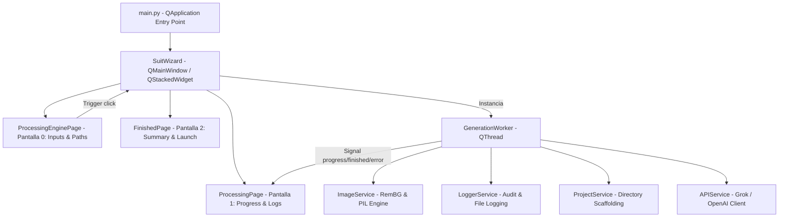

# 01_02: Arquitectura del Sistema y Diagrama C4 - ABL Suit Favicon

## 🏗️ Visión de Arquitectura

ABL Suit Favicon adopta una arquitectura en capas basada en **PySide6 (Qt6)** para la interfaz gráfica de usuario y **Pillow + RemBG** para el procesamiento pesado de imágenes en un hilo secundario independiente (`QThread`), garantizando una UI responsiva a 60 FPS sin bloqueos.

## 🧩 Componentes Principales
1. **Capa UI (`app/ui/`)**:
   - `wizard.py`: Coordinador central de navegación mediante `QStackedWidget`.
   - `pages.py`: Implementación de las tres páginas del flujo (`ProcessingEnginePage`, `ProcessingPage`, `FinishedPage`).
   - `styles.py`: Hoja de estilos centralizada QSS (`MAIN_STYLE`).
2. **Capa Worker (`app/workers/`)**:
   - `gen_worker.py`: Orquestador asíncrono en `QThread` que ejecuta los 5 pasos del pipeline de transformación gráfica.
3. **Capa de Servicios (`app/services/`)**:
   - `image_service.py`: Motor matemático de recorte, remoción de fondo, escalado y formato ICO.
   - `logger_service.py`: Singleton de registro auditado en `logs/audit.log`.
   - `project_service.py`: Gestor de carpetas y JSON de metadatos.
   - `api_service.py`: Cliente HTTP/OpenAI para Grok AI.
